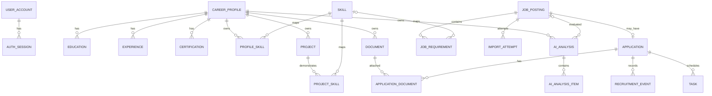

# Architecture and Data Model

## Architecture
Next.js frontend -> NestJS REST `/api/v1` -> domain modules -> Prisma -> PostgreSQL. NestJS alone accesses DB and AI provider. Documents use a persistent local volume outside public web root.

## Modules
Auth, Profile, Skills, Projects, Documents, Jobs, JobImport, Applications, Tasks, AIAnalysis, Dashboard, Prisma, Config.

## Rules
- Business rules live in NestJS services.
- DTOs validate API input; AI output is untrusted.
- Status update + recruitment event is transactional.
- AI provider is abstracted behind a backend adapter.
- URL import must block localhost/private/link-local/reserved IPs, validate redirects/DNS, restrict response size/time/content type, and not forward credentials.
- No microservices, queue, or Redis in MVP.

## ERD (conceptual)

## Data model notes
- `Application.jobPostingId` unique: max one application per job.
- `ProfileSkill(profileId, skillId)` unique.
- `ProjectSkill(projectId, skillId)` composite primary key.
- JobRequirement may have nullable Skill mapping.
- `AIAnalysis.fitScore` nullable; coverage stored separately.
- `AIAnalysis.inputSnapshot` captures profile, job, and scoring configuration relevant to that analysis.
- Restrict deleting a job while an application/analysis depends on it; user must explicitly handle dependents.
- Files are stored in volume; DB stores metadata and generated storage key.
- Use Decimal for salary amounts; validate score and weight bounds in service.
